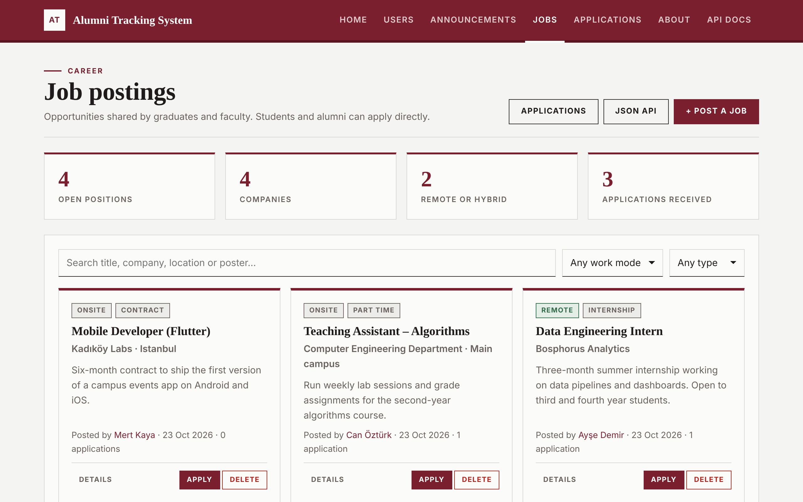
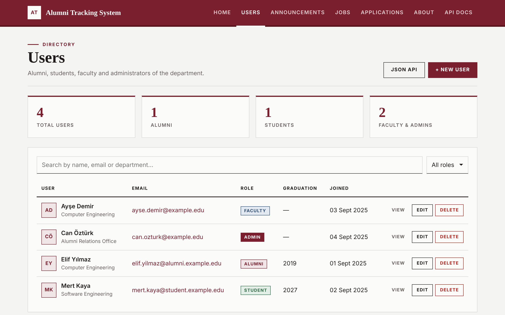
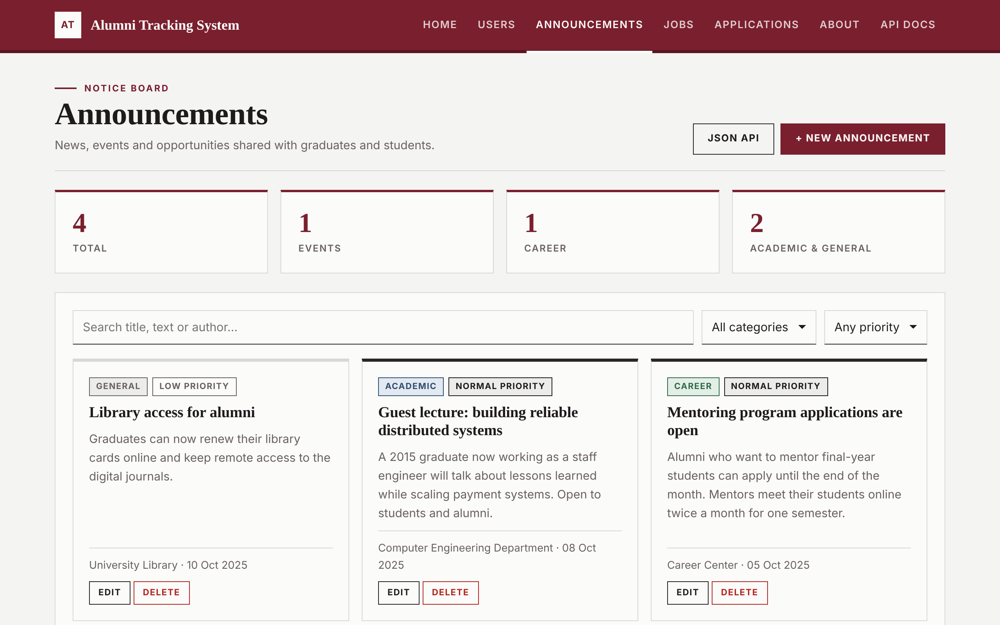
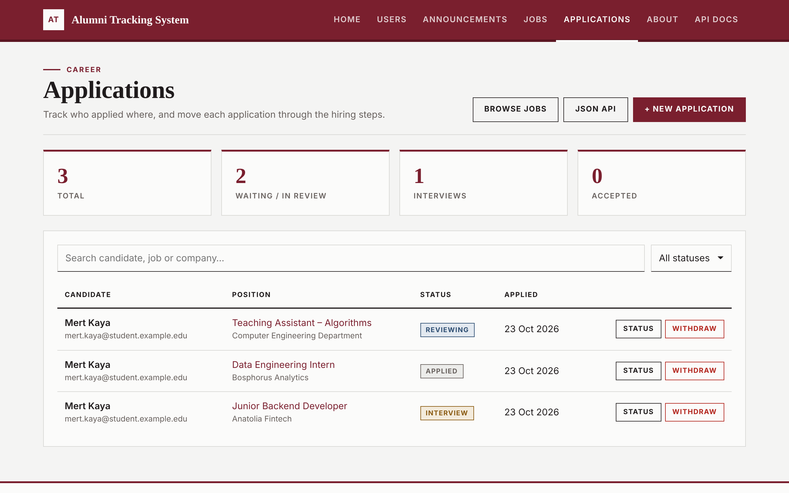

<p align="center">
  <h1 align="center">Alumni Tracking System</h1>
  <p align="center">
    <strong>Course project for keeping track of graduates, students and faculty — REST API, server-rendered pages and PostgreSQL</strong>
  </p>
  <p align="center">
    
    
    
    
    
    
    
  </p>
  <p align="center">
    
  </p>
</p>

---

Alumni Tracking System is a Node.js / Express application that keeps a department's **alumni, students, faculty and administrators** in one place. It exposes a documented **REST API** (Swagger UI included), serves **server-rendered pages** for managing the data in a browser, and stores everything in **PostgreSQL 16**. The whole stack starts with a single `docker compose up --build`.

The project was built week by week as course work. It started with an in-memory user API, moved to an MVC structure, then to PostgreSQL with migrations, and finally added relations between tables: job postings and applications.

## Features

- **REST API** — CRUD for users, announcements, job postings and applications, with filters (`?role=`, `?category=`, `?workMode=`, `?status=`, `?search=`) and plain JSON responses
- **MVC with Dual Controllers** — Every resource has an API controller (JSON, `/api/...`) and a web controller (HTML pages); both share one service layer
- **Relational Schema** — `users 1 ──< N job_postings` and `users N >──< M job_postings` through `applications`, with `ON DELETE CASCADE` on every foreign key
- **Nested Routes** — `/api/users/:id/jobs`, `/api/users/:id/applications`, `/api/jobs/:id/applications`; the parent always comes from the URL
- **Duplicate Protection** — One application per user per job, checked in the service *and* by a `UNIQUE` constraint; duplicates return `409 Conflict`
- **Validation Everywhere** — Request bodies are validated in the service layer (400 with per-field details) and repeated as `CHECK` constraints in the database
- **SQL Migrations & Seeding** — Versioned migrations tracked in `schema_migrations` (one transaction per file, advisory lock), idempotent seeds and factories
- **Server-Rendered UI** — EJS pages with live search, filters, statistics and `<dialog>` forms; every action also works **without JavaScript** through plain form posts
- **Burgundy / Off-White Design** — Custom stylesheet with serif headings, square corners on every element, no UI framework and no external assets
- **Swagger Documentation** — Full OpenAPI 3.0 document at `/api/docs`, including schemas, filters and error responses
- **One-Command Startup** — Docker Compose waits for the database healthcheck, then the API migrates, seeds and starts; data lives in a named volume
- **Tested Against Real PostgreSQL** — 124 integration and model tests with `node:test` + Supertest on a separate test database

## Architecture

```
┌──────────────────────────────────────────────────────────────┐
│                  Browser / API client                        │
│                                                              │
│   Pages (EJS + app.js)        REST clients / Swagger UI      │
│   /users  /announcements      /api/users   /api/jobs         │
│   /jobs   /applications       /api/docs    ...               │
└──────────────────────────────────────────────────────────────┘
            │ HTML                          │ JSON
            ▼                               ▼
┌──────────────────────────────────────────────────────────────┐
│                    Express 5  (src/app.js)                   │
│           Helmet · CORS · Morgan · JSON / form parsers       │
│                                                              │
│   routes/web                    routes/api                   │
│       ▼                             ▼                        │
│   controllers/web               controllers/api              │
│   render views, form posts      plain JSON responses         │
│       └──────────────┬──────────────┘                        │
│                      ▼                                       │
│   services/   validation, business rules, 404 / 409          │
│                      ▼                                       │
│   models/     parameterized SQL, joins, row mapping          │
│                                                              │
│   middleware/error-handler: HttpError + PG codes → HTTP      │
└──────────────────────────────────────────────────────────────┘
                               │ pg Pool
                               ▼
┌──────────────────────────────────────────────────────────────┐
│                 PostgreSQL 16  (db service)                  │
│   users · announcements · job_postings · applications        │
│   schema_migrations                    volume: pgdata        │
└──────────────────────────────────────────────────────────────┘
```

| Layer | Location | Responsibility |
|:---|:---|:---|
| Routes | `src/routes/api`, `src/routes/web` | Map URLs to controller functions only |
| Controllers (API) | `src/controllers/api` | Read params and body, call a service, send JSON |
| Controllers (web) | `src/controllers/web` | Render EJS views, handle form posts with redirect-after-post |
| Services | `src/services` | Validation, filters, existence checks, unique rules (409) |
| Models | `src/models` | SQL queries, joins, snake_case → camelCase mapping |
| Views | `src/views` | EJS templates with shared partials (header, flash, dialogs) |

Errors are thrown as `HttpError` and formatted in one place. API routes always get JSON, and browser pages get an HTML error page.

## Quick Start

### Prerequisites

- **Docker** with Docker Compose v2
- or **Node.js 20+** (22 LTS recommended) and a PostgreSQL 16 server for running without Docker

### Run with Docker

```bash
git clone https://github.com/AxelXoket/alumni_tracking.git
cd alumni_tracking
docker compose up --build
```

Compose starts PostgreSQL, waits for `pg_isready`, then builds and starts the API. On start, the API applies pending migrations and loads the sample data. No `.env` file is needed; every default is listed in [`.env.example`](.env.example).

| URL | Description |
|:---|:---|
| http://localhost:3000/home | Landing page with the endpoint list |
| http://localhost:3000/users | User directory |
| http://localhost:3000/announcements | Announcement board |
| http://localhost:3000/jobs | Job postings |
| http://localhost:3000/applications | Application tracking |
| http://localhost:3000/api/docs | Swagger UI |
| http://localhost:3000/api/health | Health check |

Stop with `docker compose down`. Add `-v` to also delete the database volume.

### Run without Docker

```bash
docker compose up -d db        # or point DB_* at your own PostgreSQL
cd backend
npm install
npm run dev                    # migrates, seeds and restarts on file changes
```

| Script | Description |
|:---|:---|
| `npm start` | Migrate, seed and start the server |
| `npm run dev` | Same as start, restarting on file changes |
| `npm run migrate` | Apply pending migrations only |
| `npm run seed` | Load the sample data only (idempotent) |
| `npm test` | Run the test suite against the test database |

## API Endpoints

Responses are plain JSON. Lists are arrays, and their size is also in the `X-Total-Count` header. Single resources are objects. Errors share one shape:

```json
{ "error": "Bad Request", "message": "Validation failed", "details": [{ "field": "email", "message": "email is required" }] }
```

### System

| Endpoint | Description |
|:---|:---|
| `GET /api/health` (also `/health`) | Status, uptime, runtime info, database connectivity |
| `GET /hello/:name` | Greeting for `name` (max 50 characters) |
| `GET /sum/:number1/:number2` | Adds two numbers; `400` if either is not a number |
| `GET /api/docs` · `GET /api/openapi.json` | Swagger UI · raw OpenAPI document |

### Users

| Endpoint | Description | Errors |
|:---|:---|:---|
| `GET /api/users` | List users (`?role=`, `?search=`) | 400 |
| `POST /api/users` | Create: `name`, `email` (unique), `role`, `department`, `graduationYear` | 400, 409 |
| `GET /api/users/:id` | Get one user | 404 |
| `PUT /api/users/:id` | Replace (all required fields) | 400, 404, 409 |
| `PATCH /api/users/:id` | Update some fields | 400, 404, 409 |
| `DELETE /api/users/:id` | Delete (cascades to their jobs and applications) | 404 |

### Announcements

| Endpoint | Description | Errors |
|:---|:---|:---|
| `GET /api/announcements` | List, newest first (`?category=`, `?priority=`, `?search=`) | 400 |
| `POST /api/announcements` | Create: `title`, `content`, `category`, `priority`, `author` | 400 |
| `GET` · `PUT` · `PATCH` · `DELETE /api/announcements/:id` | Read, replace, update, delete | 400, 404 |

### Job postings (one-to-many)

| Endpoint | Description | Errors |
|:---|:---|:---|
| `GET /api/users/:id/jobs` | Jobs posted by the user | 404 |
| `POST /api/users/:id/jobs` | Post a job as this user — the poster comes **only from the URL** | 400, 404 |
| `GET /api/jobs` | List, newest first (`?userId=`, `?workMode=`, `?search=`) | 400 |
| `POST /api/jobs` | Create with the poster as `userId` in the body | 400, 404 |
| `GET` · `PUT` · `PATCH` · `DELETE /api/jobs/:id` | Read, replace, update, delete (cascades to applications) | 400, 404 |

### Applications (many-to-many)

| Endpoint | Description | Errors |
|:---|:---|:---|
| `GET /api/jobs/:id/applications` | Applications received by the job | 404 |
| `POST /api/jobs/:id/applications` | Apply: `userId`, optional `status`, `coverLetter` | 400, 404, **409** |
| `GET /api/users/:id/applications` | Applications sent by the user | 404 |
| `GET /api/applications` | List (`?status=`) | 400 |
| `POST /api/applications` | Apply with `userId` and `jobPostingId` in the body | 400, 404, **409** |
| `GET /api/applications/:id` | Get one application | 404 |
| `PATCH /api/applications/:id` | Change the status: `applied` → `reviewing` → `interview` → `accepted` / `rejected` | 400, 404 |
| `DELETE /api/applications/:id` | Withdraw the application | 404 |

A second application by the same user to the same job returns exactly:

```json
{ "error": "Conflict", "message": "User has already applied for this job posting" }
```

### Examples

```bash
# create a user
curl -X POST http://localhost:3000/api/users \
  -H "Content-Type: application/json" \
  -d '{"name":"Zeynep Arslan","email":"zeynep@alumni.example.edu","graduationYear":2021}'

# Elif posts a job (poster taken from the URL)
curl -X POST http://localhost:3000/api/users/6f1c2a8e-3b7d-4c51-9a2e-0d4f8b6c1e01/jobs \
  -H "Content-Type: application/json" \
  -d '{"title":"QA Engineer","company":"Galata Software","workMode":"remote"}'

# Mert applies — sending the same request twice returns 409
curl -X POST http://localhost:3000/api/jobs/<jobId>/applications \
  -H "Content-Type: application/json" \
  -d '{"userId":"6f1c2a8e-3b7d-4c51-9a2e-0d4f8b6c1e02","coverLetter":"Final-year student, keen on testing."}'
```

## Pages

| Page | Description |
|:---|:---|
| `/home` · `/about` | Landing page with the endpoint list · tech stack and request flow |
| `/users` · `/users/:id` | Directory with role statistics, search, role filter, create / edit / delete; profile page |
| `/announcements` · `/announcements/:id` | Card board with category / priority filters and badges; detail page |
| `/jobs` · `/jobs/:id` | Job board with work-mode / type filters, post and apply dialogs; job page with its applications |
| `/applications` | Tracking table with per-status statistics, status changes and withdraw |

<p align="center">
  
  
  
</p>

The lists are rendered on the server, so every page works with JavaScript turned off: forms post to the page routes, and the controller redirects back with `?status=...` or `?error=...` (redirect-after-post). With JavaScript on, `public/js/app.js` adds the following on top, driven only by `data-*` attributes:

- forms open in `<dialog>` windows and are sent to the JSON API
- rows and cards are filtered while you type
- errors such as the 409 message are shown inside the form

## Database

PostgreSQL 16 stores all data. The full design is in the **[Data Design Document (ddd.md)](ddd.md)**: tables, constraints, indexes, cascade rules, ER diagram, and the migration and seed strategy.

| Table | Key points |
|:---|:---|
| `users` | UUID key, case-insensitive unique `email`, `role` check, `updated_at` trigger |
| `announcements` | Category / priority checks, content length check, indexed by `created_at DESC` |
| `job_postings` | `user_id` → `users` (**1:N**, cascade), work mode / employment type checks |
| `applications` | `user_id` → `users`, `job_posting_id` → `job_postings` (**N:M join**, cascade), `UNIQUE (user_id, job_posting_id)` |

| Migration | Content |
|:---|:---|
| `001_create_users_and_announcements.sql` | `set_updated_at()` trigger function, users, announcements |
| `002_create_job_postings_and_applications.sql` | job_postings, applications, foreign keys, cascades, indexes |

Sample data comes from `db/seeds/*.sql` (users, announcements) and from the **factories** in `db/factories/` (job postings, applications). The factories also provide `build()` / `create()` helpers for the tests. All seeding is idempotent (`ON CONFLICT DO NOTHING`).

## Testing

```bash
docker compose up -d db        # the tests need a PostgreSQL server
cd backend
npm test
```

The tests run against a **separate database** (`alumni_tracking_test`, created automatically when the user is allowed to). It is migrated once, then truncated and re-seeded before each test. Test files run one at a time because they share it.

| Suite | Tests | Covers |
|:---|:---:|:---|
| `system.test.js` | 19 | Health, hello, sum, pages, static files, Swagger, 404 handling |
| `users.api.test.js` | 20 | User CRUD, filters, validation, malformed JSON, 409 on duplicate email |
| `user.model.test.js` | 11 | SQL model, row mapping, trigger, unique index |
| `users.web.test.js` | 10 | Pages, escaping, form fallbacks |
| `announcements.api.test.js` | 16 | Announcement CRUD, filters, validation |
| `announcements.web.test.js` | 10 | Model, board and detail pages, form fallbacks |
| `jobs.api.test.js` | 14 | Factory, nested routes, path-only poster, cascade from users |
| `jobs.web.test.js` | 8 | Job board, detail page, post / apply / delete forms |
| `applications.api.test.js` | 11 | Apply, 409 body, concurrent duplicate requests, status changes, cascades |
| `applications.web.test.js` | 5 | Tracking page, form fallbacks, duplicate message |
| **Total** | **124** | |

## Project Structure

```
alumni_tracking/
├── docker-compose.yml                # db (PostgreSQL 16) + api, pgdata volume, healthcheck
├── .env.example                      # every setting with its default
├── ddd.md                            # data design document
├── assets/                           # README screenshots
└── backend/
    ├── Dockerfile                    # two-stage node:22-alpine image, runs as non-root "node"
    ├── package.json
    ├── public/
    │   ├── css/main.css              # burgundy / off-white theme, square corners
    │   └── js/app.js                 # dialogs, API form submits, live filters
    ├── src/
    │   ├── index.js                  # migrate → seed → listen, graceful shutdown
    │   ├── app.js                    # Express app: Helmet, CORS, Morgan, parsers, routes
    │   ├── config/index.js           # environment settings
    │   ├── controllers/
    │   │   ├── api/                  # system, user, announcement, job, application (JSON)
    │   │   └── web/                  # page, user, announcement, job, application (HTML)
    │   ├── db/
    │   │   ├── pool.js               # pg connection pool + ping
    │   │   ├── migrate.js            # migration runner (schema_migrations, advisory lock)
    │   │   ├── seed.js               # SQL seeds, then factories
    │   │   ├── migrations/           # 001_..., 002_...
    │   │   ├── seeds/                # sample users and announcements
    │   │   └── factories/            # job posting and application factories
    │   ├── docs/openapi.js           # OpenAPI 3.0 document
    │   ├── lib/                      # HttpError, JSON replies, validator, SQL + form helpers
    │   ├── middleware/               # 404 and error handlers
    │   ├── models/                   # user, announcement, job-posting, application
    │   ├── routes/
    │   │   ├── api/                  # /api/* and the JSON utility endpoints
    │   │   └── web/                  # browser pages
    │   ├── services/                 # validation and business rules
    │   └── views/                    # partials/, users/, announcements/, jobs/, applications/
    └── tests/                        # node:test + Supertest suites, helpers/database.js
```

## Configuration

Every value is optional. Docker Compose and the app fall back to the defaults below. Copy `.env.example` to `.env` in the repository root to change them.

| Variable | Default | Description |
|:---|:---|:---|
| `NODE_ENV` | `development` (`production` in Docker) | Runtime mode |
| `PORT` | `3000` | Port the API listens on |
| `HOST` | `0.0.0.0` | Interface to bind |
| `APP_NAME` | `Alumni Tracking System` | Name shown in pages and responses |
| `APP_PORT` | `3000` | Host port published by Compose |
| `DB_HOST` | `localhost` (`db` in Docker) | PostgreSQL host |
| `DB_PORT` | `5432` | PostgreSQL port |
| `DB_USER` | `alumni_app` | PostgreSQL user |
| `DB_PASSWORD` | `alumni_app_pw` | PostgreSQL password |
| `DB_NAME` | `alumni_tracking` | Database name |
| `DB_EXTERNAL_PORT` | `5432` | Host port published for PostgreSQL |
| `TEST_DB_NAME` | `alumni_tracking_test` | Database used by `npm test` |
| `SEED_ON_START` | `true` | Load the sample data on every start |

## Weekly Progress

- [x] **Weeks 1–3** — Express setup, health / hello / sum endpoints, home and about pages, Docker Compose, in-memory user CRUD, Swagger docs
- [x] **Week 4 (in class)** — MVC refactor: `UserModel`, separate API and web controllers, `/users` page
- [x] **Week 4 (homework)** — Announcements with the same MVC pattern and an `/announcements` board
- [x] **Week 5** — PostgreSQL persistence, SQL migrations, seeds, `pgdata` volume, [ddd.md](ddd.md)
- [x] **Week 6 (in class)** — Job postings (1:N) and applications (N:M), nested routes, 409 on duplicate application, factory seeding
- [x] **Week 6 (homework)** — Pages for job postings and applications
- [x] Plain JSON responses, burgundy / off-white redesign, dependency audit clean

---

<p align="center">
  <sub>Built as course work — from an in-memory API to a relational, tested, one-command stack.</sub>
</p>
