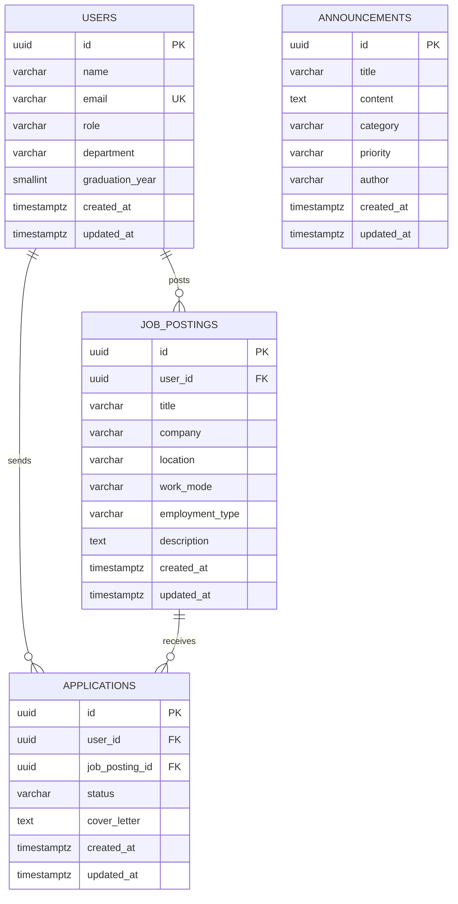

# Data Design Document (DDD)

**Alumni Tracking System — database design, persistence and relations (weeks 5–6)**

← Back to the [README](README.md)

| | |
| --- | --- |
| Database | PostgreSQL 16 (`postgres:16-alpine` container) |
| Access from Node.js | `pg` connection pool (`backend/src/db/pool.js`) |
| Schema changes | Plain SQL migrations in `backend/src/db/migrations/` |
| Sample data | Idempotent SQL seeds in `backend/src/db/seeds/` + factories in `backend/src/db/factories/` |
| Persistence | Named Docker volume `pgdata` |

## Contents

1. [Purpose](#1-purpose)
2. [Infrastructure and persistence](#2-infrastructure-and-persistence)
3. [Entities](#3-entities)
4. [Conventions and constraints](#4-conventions-and-constraints)
5. [Indexes](#5-indexes)
6. [Relations and the ER diagram](#6-relations-and-the-er-diagram)
7. [Migrations](#7-migrations)
8. [Seed data](#8-seed-data)
9. [Configuration](#9-configuration)
10. [How the application uses the database](#10-how-the-application-uses-the-database)

---

## 1. Purpose

In weeks 3 and 4 users and announcements lived in memory, so every restart
lost all changes. Week 5 moves both models to PostgreSQL. This document
records how the data is stored: the tables and their rules, the indexes and
why they exist, and how the schema is created and kept up to date.

The models kept their public methods (`findAll`, `findById`, `create`,
`update`, `delete`, ...), so the services, controllers and views did not have
to change when the storage changed.

Week 6 adds the first relations between tables. Users post **job postings**
(one-to-many). Users also **apply** to job postings through the
`applications` table, which turns the users–jobs relation into a
many-to-many relation with its own data (status, cover letter).

## 2. Infrastructure and persistence

```yaml
services:
  db:
    image: postgres:16-alpine
    volumes:
      - pgdata:/var/lib/postgresql/data   # data survives container rebuilds
    healthcheck:
      test: ["CMD-SHELL", "pg_isready -U $${POSTGRES_USER} -d $${POSTGRES_DB}"]
  api:
    depends_on:
      db:
        condition: service_healthy        # API starts only when the DB accepts connections

volumes:
  pgdata:
```

- **Named volume `pgdata`.** PostgreSQL keeps its files in
  `/var/lib/postgresql/data`, which is mounted from a Docker-managed volume.
  `docker compose down` and `docker compose up --build` keep the data; only
  `docker compose down -v` deletes it.
- **Start order.** The `db` service reports healthy only after `pg_isready`
  succeeds. The `api` service waits for that, then runs the migrations and
  seeds before it starts listening, so the first request already sees the
  full schema.
- **Network.** Compose puts both services on the project's default network.
  The API reaches the database by its service name, `db`. Port 5432 is also
  published on the host (`DB_EXTERNAL_PORT`) for tools such as `psql`, and
  for running the tests.

## 3. Entities

### 3.1 `users`

People known to the system: graduates, current students, faculty members
and administrators.

| Column | Type | Null | Default | Rules |
| --- | --- | --- | --- | --- |
| `id` | `uuid` | no | `gen_random_uuid()` | primary key |
| `name` | `varchar(100)` | no | | at least 2 non-blank characters |
| `email` | `varchar(255)` | no | | unique, case-insensitive (`lower(email)` index) |
| `role` | `varchar(20)` | no | `'alumni'` | one of `alumni`, `student`, `faculty`, `admin` |
| `department` | `varchar(120)` | yes | | |
| `graduation_year` | `smallint` | yes | | between 1950 and 2100 |
| `created_at` | `timestamptz` | no | `now()` | |
| `updated_at` | `timestamptz` | no | `now()` | refreshed by trigger |

### 3.2 `announcements`

Notices published to the community.

| Column | Type | Null | Default | Rules |
| --- | --- | --- | --- | --- |
| `id` | `uuid` | no | `gen_random_uuid()` | primary key |
| `title` | `varchar(150)` | no | | at least 3 non-blank characters |
| `content` | `text` | no | | 10–5000 characters |
| `category` | `varchar(20)` | no | | one of `general`, `academic`, `career`, `event` |
| `priority` | `varchar(10)` | no | `'normal'` | one of `low`, `normal`, `high` |
| `author` | `varchar(100)` | no | | free text: a person or an office |
| `created_at` | `timestamptz` | no | `now()` | |
| `updated_at` | `timestamptz` | no | `now()` | refreshed by trigger |

`author` is free text rather than a foreign key to `users`. Announcements
usually come from offices ("Career Center"), not from individual accounts,
and an announcement should stay readable even if the person who typed it
leaves.

### 3.3 `job_postings` (week 6)

A job or internship shared by a user, usually an alumnus or a faculty member.

| Column | Type | Null | Default | Rules |
| --- | --- | --- | --- | --- |
| `id` | `uuid` | no | `gen_random_uuid()` | primary key |
| `user_id` | `uuid` | no | | **FK → `users.id`, `ON DELETE CASCADE`** (the poster) |
| `title` | `varchar(150)` | no | | at least 2 non-blank characters |
| `company` | `varchar(150)` | no | | at least 2 non-blank characters |
| `location` | `varchar(120)` | yes | | |
| `work_mode` | `varchar(10)` | no | `'onsite'` | one of `onsite`, `hybrid`, `remote` |
| `employment_type` | `varchar(20)` | no | `'full_time'` | one of `full_time`, `part_time`, `internship`, `contract` |
| `description` | `text` | yes | | up to 5000 characters |
| `created_at` / `updated_at` | `timestamptz` | no | `now()` | `updated_at` refreshed by trigger |

### 3.4 `applications` (week 6, join entity)

A user's application to a job posting.

| Column | Type | Null | Default | Rules |
| --- | --- | --- | --- | --- |
| `id` | `uuid` | no | `gen_random_uuid()` | primary key |
| `user_id` | `uuid` | no | | **FK → `users.id`, `ON DELETE CASCADE`** (the candidate) |
| `job_posting_id` | `uuid` | no | | **FK → `job_postings.id`, `ON DELETE CASCADE`** |
| `status` | `varchar(20)` | no | `'applied'` | one of `applied`, `reviewing`, `interview`, `accepted`, `rejected` |
| `cover_letter` | `text` | yes | | up to 2000 characters |
| `created_at` / `updated_at` | `timestamptz` | no | `now()` | `updated_at` refreshed by trigger |
| | | | | **`UNIQUE (user_id, job_posting_id)`**, constraint `applications_user_job_uq` |

## 4. Conventions and constraints

- **UUID primary keys.** Ids are generated by the database
  (`gen_random_uuid()`, built into PostgreSQL 13+). They can be exposed in
  URLs without revealing how many rows exist.
- **`snake_case` columns, `camelCase` JSON.** The models map
  `graduation_year` → `graduationYear`, `created_at` → `createdAt`, and so
  on. API clients never see column names.
- **`timestamptz` everywhere.** Times are stored in UTC and returned as
  ISO 8601 strings.
- **`updated_at` is the database's job.** The `set_updated_at()` trigger
  function runs `BEFORE UPDATE` on both tables. The application never sets
  it by hand.
- **Validation in two places.** The service layer validates every request
  and returns readable `400` / `409` errors. `CHECK` constraints and the
  unique index repeat the important rules, so bad data cannot get in through
  another path (for example `psql`, or two requests racing each other).
  If a constraint fires anyway, the error handler maps the PostgreSQL error
  code to an HTTP status:

  | PostgreSQL code | Meaning | HTTP |
  | --- | --- | --- |
  | `23505` | unique violation | 409 |
  | `23514` | check violation | 400 |
  | `22P02` | invalid input syntax | 400 |

- **Malformed ids** are rejected in the model before any query runs, so
  `/api/users/abc` is a clean `404` instead of a database error.

### 4.1 Referential integrity and cascades (week 6)

```text
users ──(ON DELETE CASCADE)──► job_postings ──(ON DELETE CASCADE)──► applications
  └─────────────────────────(ON DELETE CASCADE)──────────────────────────┘
```

| When this is deleted | These are deleted too | Why |
| --- | --- | --- |
| a user | the jobs they posted, the applications they sent, and every application to their jobs | a posting or application without its owner has no meaning; no orphan rows remain |
| a job posting | its applications | applications only exist for a job |
| an application | nothing | withdrawing an application touches nothing else |

The API never has to clean up by hand. One `DELETE` lets PostgreSQL remove
the dependent rows in the same transaction.

### 4.2 One application per user per job → `409 Conflict`

The rule "a user can apply to the same job only once" is enforced twice:

1. **Service check.** Before inserting, `application.service` looks for an
   existing `(user_id, job_posting_id)` pair. If one exists it answers
   `409 Conflict` with the body:

   ```json
   { "error": "Conflict", "message": "User has already applied for this job posting" }
   ```

2. **Database constraint.** `UNIQUE (user_id, job_posting_id)`. If two
   identical requests arrive at the same moment, both can pass step 1, but
   only one `INSERT` succeeds. The other fails with PostgreSQL error `23505`,
   which the service converts to the same `409` body. A test sends two
   parallel requests to cover this race.

## 5. Indexes

| Index | Table | Columns | Used by |
| --- | --- | --- | --- |
| `users_pkey` | users | `id` | lookups by id |
| `users_email_lower_uq` | users | `lower(email)` (unique) | duplicate-email check and login-style lookups; enforces case-insensitive uniqueness |
| `users_role_idx` | users | `role` | `GET /api/users?role=...`, role statistics |
| `announcements_pkey` | announcements | `id` | lookups by id |
| `announcements_created_at_idx` | announcements | `created_at DESC` | the board, which always lists newest first |
| `announcements_category_created_idx` | announcements | `category, created_at DESC` | `?category=` filter, already in display order |
| `job_postings_user_id_idx` | job_postings | `user_id` | `GET /api/users/:id/jobs`; also speeds up the cascade when a user is deleted (PostgreSQL does not index foreign keys on its own) |
| `job_postings_created_at_idx` | job_postings | `created_at DESC` | the job list, newest first |
| `applications_user_job_uq` | applications | `user_id, job_posting_id` (unique) | the duplicate rule; its leading column also serves `GET /api/users/:id/applications` |
| `applications_job_posting_id_idx` | applications | `job_posting_id` | `GET /api/jobs/:id/applications`, application counts per job, cascade from jobs |
| `applications_status_idx` | applications | `status` | `?status=` filter and status statistics |

Free-text search (`?search=`) uses `ILIKE '%term%'`, which cannot use a
B-tree index. At the current data size a sequential scan is fine. If the
tables grow, a `pg_trgm` GIN index is the next step.

## 6. Relations and the ER diagram

| Relation | Type | Implemented by | API |
| --- | --- | --- | --- |
| user → job postings | one-to-many | `job_postings.user_id` | `GET/POST /api/users/:id/jobs` |
| users ↔ job postings | many-to-many | `applications` (join entity with `status`, `cover_letter`) | `GET/POST /api/jobs/:id/applications`, `GET /api/users/:id/applications` |

In nested routes the parent id always comes from the URL. For example,
`POST /api/users/:id/jobs` uses `:id` as the poster and ignores any `userId`
in the body, so a client cannot post a job in someone else's name by editing
the payload.



`announcements` has no foreign key (see the note on `author` in 3.2).

## 7. Migrations

- Files live in `backend/src/db/migrations/` and are named
  `NNN_description.sql`. They run in name order.
- `backend/src/db/migrate.js` records each applied file in the
  `schema_migrations` table (`name`, `applied_at`). Files already listed
  there are skipped, so running the migrator again is always safe.
- Each file runs inside its own transaction. If any statement fails, the
  whole file is rolled back, nothing is recorded, and the app does not start.
- A PostgreSQL advisory lock stops two instances from migrating at the same
  time.
- Migrations run automatically on every start. They can also be run by hand
  with `npm run migrate`.
- An applied migration is never edited. A schema change means a new file.

| File | Content |
| --- | --- |
| `001_create_users_and_announcements.sql` | `set_updated_at()` trigger function, `users`, `announcements`, their constraints, indexes and triggers |
| `002_create_job_postings_and_applications.sql` | `job_postings` (FK to users), `applications` (FKs to users and job_postings, unique pair), cascades, indexes, triggers |

## 8. Seed data

Seeding runs in two steps (`backend/src/db/seed.js`):

1. **SQL seed files.** `seeds/001_users_and_announcements.sql` inserts 4
   users (one per role) and 4 announcements (one per category), with fixed
   ids so the README examples and the tests can refer to them.
2. **Factories** (week 6). They run after the SQL seeds because they need
   users.
   - `factories/job-posting.factory.js` inserts 4 sample job postings. Each
     is assigned to an existing user, preferring alumni and faculty, so the
     factory never hard-codes user ids. It also exposes `build(overrides)`
     (plain data, no database) and `create(overrides)` (insert and return),
     which the tests use to create jobs.
   - `factories/application.factory.js` inserts 3 sample applications from
     a student to those jobs, skipping any job the student posted. It has
     the same `build` / `create` helpers.

All inserts use `ON CONFLICT DO NOTHING`. Seeding fills an empty database and
never overwrites rows changed through the app. It runs on every start unless
`SEED_ON_START=false`, and can be run by hand with `npm run seed`.

## 9. Configuration

| Variable | Default | Used for |
| --- | --- | --- |
| `DB_HOST` | `localhost` (`db` inside Compose) | database host |
| `DB_PORT` | `5432` | database port |
| `DB_USER` | `alumni_app` | login role (also `POSTGRES_USER` for the container) |
| `DB_PASSWORD` | `alumni_app_pw` | password (also `POSTGRES_PASSWORD`) |
| `DB_NAME` | `alumni_tracking` | database name (also `POSTGRES_DB`) |
| `TEST_DB_NAME` | `alumni_tracking_test` | separate database used by `npm test` |
| `SEED_ON_START` | `true` | load the sample data on start |

Real secrets belong in `.env`, which git ignores. Only `.env.example` is
committed.

## 10. How the application uses the database

```text
controller ──► service ──► model ──► pg Pool ──► PostgreSQL
                              │
                              └─ parameterized SQL ($1, $2, ...) only;
                                 user input is never concatenated into SQL
```

- One shared `pg.Pool` (max 10 connections) is created the first time it is
  needed, and is closed on `SIGINT` / `SIGTERM`.
- Updates build their `SET` list only from known columns, so a request body
  cannot change `id` or `created_at`.
- Job and application reads `JOIN` the related tables, so each job carries a
  `postedBy` summary and each application carries `candidate` and `job`
  summaries. The pages can show names without extra requests.
- The tests run against a separate database (`TEST_DB_NAME`). They migrate
  it, then truncate (`TRUNCATE users, announcements CASCADE`, which also
  empties the dependent tables) and re-seed it before each test.

← Back to the [README](README.md)
